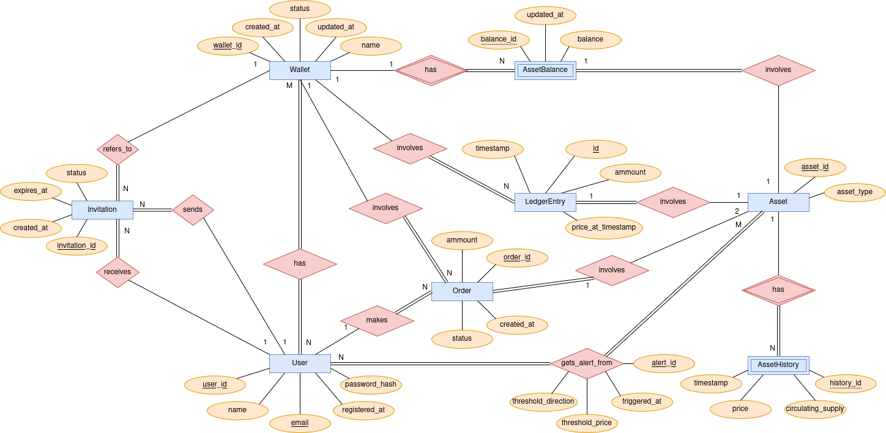
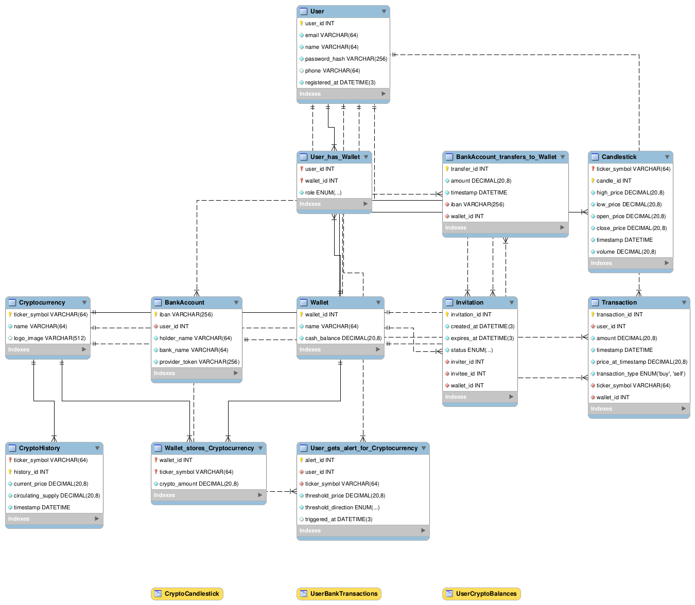

# CryptofolioDB

A relational database for a cryptocurrency portfolio and trading application, designed and implemented in MySQL.

Team project for the **Databases** course at ECE AUTH during the 2025–2026 academic year.

**Team 39:** Daskalopoulos Aristeidis · Lavdakis Georgios · Rousomanis Georgios



## What the database models

The application lets users manage crypto wallets, alone or shared with other users. The database stores:

- **Users and wallets:** each user owns at least one wallet and can invite other users to share it.
- **Bank accounts and transfers:** users link bank accounts and move money into their wallets.
- **Trades:** buy and sell transactions per wallet and cryptocurrency.
- **Market data:** price history and candlesticks for each cryptocurrency.
- **Alerts:** price thresholds a user wants to be notified about.

## Contents

| Folder | Contents |
|---|---|
| `deliverable-1` | Requirements, ER model, relational schema and example queries in relational algebra (report in Greek) |
| `deliverable-2` | MySQL implementation: schema script, MySQL Workbench model, user accounts and SQL queries |

## Implementation

- **12 tables** with primary and foreign keys, created by `deliverable-2/CryptofolioDB.sql` together with sample data.
- **3 views:** `UserCryptoBalances`, `UserBankTransactions` and `CryptoCandlestick`.
- **2 database users** (`deliverable-2/users.sql`): an administrator with full privileges and an application user limited to the operations the application needs on each table.
- **4 example queries** (`deliverable-2/queries`), such as the total Bitcoin a user holds across all wallets, and a user's Bitcoin transactions after a given date.



## Running it

With MySQL 8 installed:

```bash
mysql -u root -p < deliverable-2/CryptofolioDB.sql
mysql -u root -p < deliverable-2/users.sql
mysql -u root -p < deliverable-2/queries/query1.sql
```
